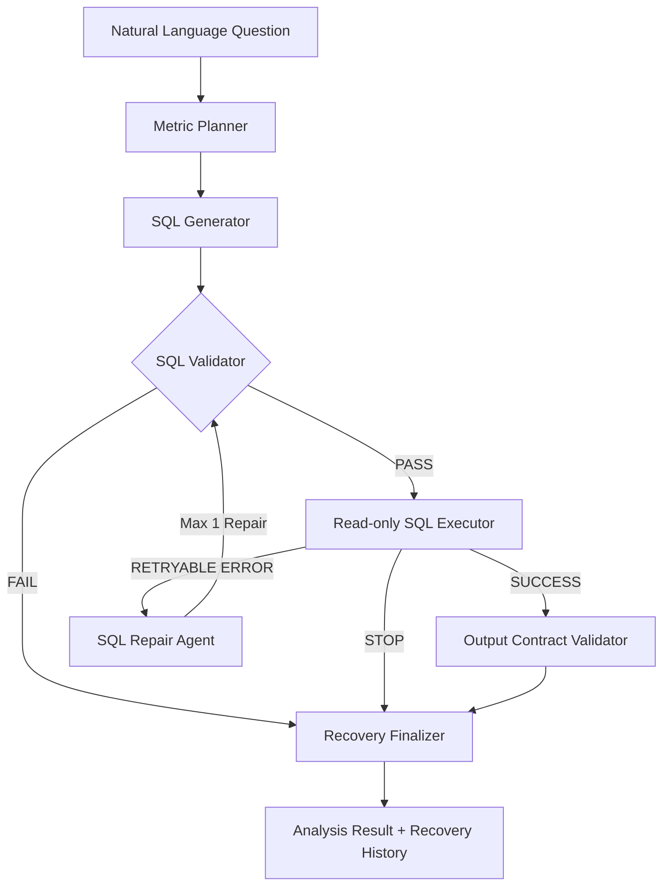

# Agentic Data Analytics Platform

**LangGraph 기반 자연어 데이터 분석 및 SQL 자동 복구 플랫폼**

자연어로 데이터 분석을 요청하면 AI Agent가 데이터베이스 스키마와 비즈니스 지표 정의를 기반으로 SQL을 생성하고, 실행 결과를 검증하며, 복구 가능한 SQL 오류를 자동으로 수정하는 데이터 분석 프로젝트입니다.

단순한 Text-to-SQL 구현을 넘어 **Metric-driven Analytics, SQL Validation, Read-only Execution, Error Recovery, Automated Evaluation**을 통해 분석의 정확성과 실행 안정성을 확보하는 것을 목표로 합니다.

**Current Phase: SQL Safety Hardening 완료 · Schema RAG 검색 계층 구현 및 평가 완료 · Hybrid Retrieval 개발 예정**

---

## 1. Project Overview

일반적인 데이터 분석 과정에서는 자연어 요구사항을 이해하고, 데이터 구조를 확인하고, SQL을 작성한 뒤 결과를 검증하는 과정이 반복됩니다.

LLM을 활용하면 SQL 작성 과정을 자동화할 수 있지만, SQL이 정상적으로 실행된다고 해서 분석 결과까지 정확하다고 보장할 수는 없습니다.

이 프로젝트는 다음 문제를 해결하는 데 초점을 맞췄습니다.

- **Metric Consistency:** 같은 비즈니스 지표를 일관된 기준으로 계산

- **SQL Reliability:** 잘못된 테이블·컬럼 참조 및 SQL 실행 오류 처리

- **Execution Safety:** LLM 생성 SQL을 제한된 데이터베이스 권한으로 실행

- **Result Verification:** 요청한 지표와 실제 반환 컬럼의 일치 여부 확인

- **Recovery & Traceability:** SQL 수정 과정과 최종 복구 상태 기록

### Example Questions

> 배송 완료 주문의 평균 주문 금액은?

> 월별 주문 수와 상품 매출 추이를 알려줘.

> 카테고리별 주문 수와 판매 상품 수를 비교해줘.

> 배송 지연율과 평균 리뷰 점수를 알려줘.

현재는 Olist E-commerce 데이터의 정형 분석 질문을 대상으로 구현 및 평가했습니다.

---

## 2. Architecture

### 2.1 Implemented Agent Workflow



### 2.2 Target Platform Architecture

최종적으로는 자연어 요청을 비동기적으로 처리하고, 정형·비정형 데이터 분석을 결합하는 플랫폼으로 확장할 계획입니다.

```text
User / Slack
      │
      ▼
     n8n
      │
      ▼
   FastAPI
      │
      ▼
    Kafka
      │
      ▼
  LangGraph
      │
      ├── Metric Planner
      ├── SQL Analysis
      ├── RAG / Context
      ├── Python Analysis
      ├── Result Validator
      └── Report Agent
      │
      ▼
PostgreSQL / pgvector
      │
      ▼
 Analysis Result
      │
      ├── Slack
      └── BI Dashboard
```

> 위 구조는 목표 아키텍처입니다. 현재 구현된 범위는 PostgreSQL 기반 데이터 계층, LangGraph Text-to-SQL 및 SQL Recovery Workflow, 독립적인 pgvector Schema RAG 검색 계층입니다. RAG 검색 결과를 LangGraph에 주입하는 기능과 Kafka, n8n, Slack 자동화는 아직 통합되지 않았습니다.

---

## 3. Current Progress

### Data & Backend Foundation

- [x] Python 3.12 가상환경 및 프로젝트 구성

- [x] FastAPI 기본 프로젝트 구조 및 DB 연결

- [x] Docker 기반 PostgreSQL 16 구축

- [x] Olist 데이터 프로파일링

- [x] PK / FK 후보 및 데이터 관계 검증

- [x] PostgreSQL Schema 설계

- [x] Olist 데이터 적재 및 Row Count 검증

- [x] Gold Query 6개 작성

- [x] pytest 기반 데이터 검증

### Agentic Analytics

- [x] LangGraph 기반 분석 Workflow

- [x] Metric Registry / Dimension Registry

- [x] Structured Metric Planner

- [x] LLM 기반 SQL Generator

- [x] sqlglot AST 기반 SQL Validator (단일 SELECT, 테이블·스키마·함수 검증)

- [x] Read-only SQL Executor

- [x] Output Contract Validator

- [x] PostgreSQL SQLSTATE Error Classifier

- [x] SQL Repair Agent

- [x] 최대 1회 SQL 재생성 및 재검증

- [x] Conditional Routing

- [x] Recovery History / Recovery Finalizer

- [x] AST 기반 SQL Validator 및 함수 Allowlist

- [x] SQL 결과 최대 1,000행 제한 및 초과 감지

- [x] pgvector 및 Schema RAG 검색 계층 구축

- [x] RAG 문서 33개 생성·임베딩·저장

- [x] 한국어 Context Retriever 및 검색 평가

- [ ] 서버 측 실행 자원 제한 추가 강화

- [ ] Metric Plan 기반 Hybrid Context Retriever

- [ ] LangGraph SQL Generator에 검색 문맥 통합

- [ ] Python Analysis Agent

- [ ] Report Agent

### Platform Integration

- [ ] Kafka Worker 및 비동기 요청 처리

- [ ] Kafka Retry / DLQ

- [ ] n8n Workflow

- [ ] Slack Integration

- [ ] BI Dashboard Integration

### Evaluation

- [x] Gold Query Ground Truth 구축

- [x] Single-row / Multi-row SQL 결과 비교

- [x] Text-to-SQL Evaluation v2

- [x] SQL Recovery 단위 테스트 및 통합 테스트

- [x] 실제 LLM + PostgreSQL 복구 E2E 검증

- [x] Gold Query 6개 AST 회귀 검증

- [x] Retrieval 평가 5개 질문 (Hit@5, Recall@5, MRR@5, Required Coverage@5)

- [ ] 반복 실행 및 질문 표현 변형 평가

- [ ] Single-Agent vs Multi-Agent 비교

- [ ] Latency / Token Usage / Cost 평가

---

## 4. Dataset

프로젝트의 분석 데이터로 **Brazilian E-Commerce Public Dataset by Olist**를 사용합니다.

| Dataset              | Description   |

| -------------------- | ------------- |

| Customers            | 고객 정보         |

| Orders               | 주문 정보 및 배송 상태 |

| Order Items          | 주문별 상품 및 가격   |

| Payments             | 주문 결제 정보      |

| Reviews              | 리뷰 및 평점       |

| Products             | 상품 및 카테고리     |

| Sellers              | 판매자 정보        |

| Category Translation | 상품 카테고리 영문 변환 |

| Geolocation          | 우편번호 기반 위치 정보 |

원본 CSV 파일은 저장소에 포함하지 않으며 로컬 `data/raw/` 경로에서 관리합니다.

---

## 5. Database Design & Data Quality

데이터 적재에 앞서 원본 CSV의 Key 관계와 데이터 품질을 검증하고 PostgreSQL Schema를 설계했습니다.

```text
customers
    │
    ▼
  orders
    │
    ├──────────────► order_payments
    ├──────────────► order_reviews
    │
    ▼
order_items
    │
    ├──────────────► products
    │                   │
    │                   ▼
    │            category_translation
    │
    └──────────────► sellers
```

### Data Quality Findings

**1. Review Primary Key**

`review_id`는 단독으로 Unique하지 않아 `(review_id, order_id)` 복합키를 사용했습니다.

**2. Category Translation Missing Values**

다음 두 카테고리는 번역 데이터에 존재하지 않습니다.

```text
pc_gamer
portateis_cozinha_e_preparadores_de_alimentos
```

해당 관계에 물리적인 Foreign Key를 적용하지 않고 분석 시 `LEFT JOIN`과 원본 카테고리 대체 처리를 사용합니다.

**3. Geolocation Duplicate ZIP Prefix**

동일 ZIP Prefix에 복수의 위치 정보가 존재하므로 이를 단순 Primary Key 또는 Foreign Key로 사용하지 않았습니다.

---

## 6. Data Ingestion

Olist 9개 테이블의 적재 결과를 검증했습니다.

| Table                |          Rows |

| -------------------- | ------------: |

| customers            |        99,441 |

| category_translation |            71 |

| products             |        32,951 |

| sellers              |         3,095 |

| orders               |        99,441 |

| order_items          |       112,650 |

| order_payments       |       103,886 |

| order_reviews        |        99,224 |

| geolocation          |     1,000,163 |

| **Total**            | **1,550,922** |

---

## 7. Agent Workflow & Core Components

### 7.1 Metric Planner

사용자의 자연어 질문을 구조화된 Metric Plan으로 변환합니다.

Metric Plan은 Pydantic Schema를 사용하며 다음 정보를 포함합니다.

- Intent: `aggregation`, `comparison`, `trend`, `detail`

- Metrics: Metric Registry에 정의된 정규 지표

- Dimensions: `month`, `category`

- Filters: 분석에 필요한 비즈니스 필터

Metric Registry는 지표의 비즈니스 의미를 관리하고, SQL Generator가 해당 정의를 따르도록 유도합니다.

### 7.2 SQL Generator

질문, Metric Plan, Database Schema, Business Rules, Dimension Registry를 활용해 PostgreSQL SQL을 생성합니다.

출력 컬럼에는 정규 지표명과 차원명을 사용하도록 설계했습니다.

### 7.3 SQL Validator

`sqlglot` 기반 AST(Abstract Syntax Tree)로 LLM 생성 SQL의 구조를 검증합니다.

- 단일 SELECT 문장만 허용하고 다중 SQL 문장과 DML/DDL을 차단
- 허용된 Olist 테이블 및 `public` 스키마 검사
- SQL 함수 Allowlist 검사
- CTE, CAST, CASE WHEN, FILTER 등 정상 분석 구문 지원
- 파싱 실패 및 정책 위반 SQL 실행 차단

현재 Validator는 완전한 SQL 보안 경계가 아닙니다. 읽기 전용 PostgreSQL 계정, 타임아웃, 결과 크기 제한을 함께 사용합니다.

### 7.4 Read-only SQL Executor

LLM이 생성한 SQL은 데이터 적재용 계정이 아닌 별도 PostgreSQL 계정으로 실행합니다.

| DB Account         | Usage                |

| ------------------ | -------------------- |

| `analytics_user`   | 데이터 적재 및 스키마 관리      |

| `analytics_reader` | LLM 생성 SQL의 읽기 전용 실행 |

분석 계정에는 다음 제약을 구성했습니다.

```text
SELECT privilege
default_transaction_read_only = on
statement_timeout = 10s
```

SQL Executor는 SQLAlchemy의 별도 `read_engine`을 사용합니다. 쿼리 결과는 최대 **1,000행**까지 반환하며, 초과 시 `result_limit_exceeded`를 보고하고 결과를 정상 집계로 취급하지 않습니다. 이 제한이 DB 서버의 실행 메모리·CPU 사용량 자체를 제한하는 것은 아닙니다.

### 7.5 Output Contract Validator

SQL이 성공적으로 실행되더라도 반환 결과가 요청한 지표와 일치하지 않을 수 있습니다.

이를 감지하기 위해 Metric Plan에 정의된 지표·차원과 SQL 실행 결과의 컬럼 구성을 비교합니다.

검사 항목에는 필수 컬럼 누락과 예상하지 않은 컬럼 반환이 포함됩니다.

단, Output Contract 검증은 결과 구조를 검사하는 기능이며, 모든 수치의 의미적 정확성을 보증하지 않습니다.

---

## 8. SQL Error Recovery

### 8.1 SQLSTATE Error Classification

PostgreSQL 오류 코드를 기반으로 복구 가능한 오류를 분류합니다.

| SQLSTATE | Error             | Recovery  |

| -------- | ----------------- | --------- |

| `42601`  | Syntax Error      | Candidate |

| `42703`  | Undefined Column  | Candidate |

| `42P01`  | Undefined Table   | Candidate |

| `42501`  | Permission Denied | Stop      |

| `57014`  | Query Canceled    | Stop      |

| Other    | Unknown           | Stop      |

### 8.2 SQL Repair Agent

복구 가능한 오류가 발생하면 기존 질문, Metric Plan, 실패 SQL, 데이터베이스 스키마 및 오류 정보를 기반으로 수정 SQL을 생성합니다.

수정 SQL은 기존 Validator와 읽기 전용 Executor를 다시 통과합니다.

```text
SQL Execution Error
        │
        ▼
Error Classification
        │
        ├── Non-retryable → Stop
        │
        ▼
SQL Repair Agent
        │
        ▼
SQL Validator
        │
        ▼
SQL Executor
```

무한 재시도를 방지하기 위해 SQL 재생성 횟수는 **최대 1회**로 제한합니다.

### 8.3 Recovery Tracking

복구 시도 과정에서 다음 정보를 State에 저장합니다.

```json
{
  "attempt": 1,
  "failed_sql": "SELECT COUNT(nonexistent_column) ...",
  "error_type": "undefined_column",
  "repaired_sql": "SELECT COUNT(DISTINCT order_id) ...",
  "status": "recovered"
}
```

Recovery Finalizer는 실행 결과와 Output Contract 검증 결과에 따라 상태를 확정합니다.

| Status          | Meaning                 |

| --------------- | ----------------------- |

| `not_attempted` | SQL 복구 시도 없음            |

| `recovered`     | 수정 SQL 실행 및 결과 계약 검증 성공 |

| `failed`        | 복구 시도 후 검증 또는 실행 실패     |

### 8.4 End-to-End Recovery Example

**Test Question**

> 배송 완료된 주문 수를 알려줘.

**Initial SQL**

```sql
SELECT COUNT(nonexistent_column) AS delivered_orders
FROM orders
WHERE order_status = 'delivered';
```

**PostgreSQL Error**

```text
undefined_column
```

**LLM Repaired SQL**

```sql
SELECT COUNT(DISTINCT orders.order_id) AS delivered_orders
FROM orders
WHERE orders.order_status = 'delivered';
```

**Verified Result**

```text
Retry Count: 1
SQL Valid: True
Execution Error: None
Contract Valid: True
Result: [{'delivered_orders': 96478}]
Recovery Status: recovered
Graph Recovery E2E: PASS
```

이 테스트는 실제 PostgreSQL과 OpenAI 모델을 사용하며, 최초 SQL Generator만 오류를 재현하는 테스트용 함수로 대체했습니다.

---

## 9. Gold Queries & Evaluation

LLM이 생성한 SQL의 실행 성공 여부만으로는 분석 정확성을 판단하기 어렵습니다.

따라서 사람이 검증한 Gold Query를 Ground Truth로 활용합니다.

| Gold Query | Description          |

| ---------- | -------------------- |

| GQ01       | 배송 완료 주문 수 및 매출 집계   |

| GQ02       | Average Order Value  |

| GQ03       | 월별 주문 수 및 상품 매출      |

| GQ04       | 카테고리별 주문 수·상품 수 및 매출 |

| GQ05       | 배송 지연율               |

| GQ06       | 리뷰 집계 및 평균 점수        |

### Reference Metrics

| Metric               |        Result |

| -------------------- | ------------: |

| Delivered Orders     |        96,478 |

| Sold Items           |       110,197 |

| Product Revenue      | 13,221,498.11 |

| Freight Value        |  2,198,275.64 |

| Gross Item Value     | 15,419,773.75 |

| Average Order Value  |        137.04 |

| Delivery Delay Rate  |         8.11% |

| Average Review Score |          4.09 |

Average Order Value는 개별 상품 가격의 평균이 아니라 배송 완료 주문별 상품 매출 합계의 평균입니다.

### Text-to-SQL Evaluation v2

평가 범위는 단일 행 집계, 월별 다중 행, 카테고리별 다중 행을 포함합니다.

```text
=== Evaluation Summary ===
Passed: 6/6
Execution Accuracy: 100.00%
```

이 수치는 **정의된 6개 Gold Query에 대한 단일 평가 실행 결과**이며, 일반적인 자연어 질문 전체에 대해 100% 정확도를 보장한다는 의미는 아닙니다.

월별 결과 23행과 카테고리별 결과 74행도 검증했습니다. 평가기는 차원 키 기준 비교, 행 누락·중복 검출 및 수치 비교를 지원합니다.

평가 실행:

```powershell
python -m scripts.evaluate_text_to_sql
```

평가 과정에서 OpenAI API 호출 비용이 발생합니다.

---

## 10. Automated Testing

pytest를 통해 데이터베이스 지표, 결과 계약, 오류 분류, 조건부 라우팅, SQL Repair, Recovery Finalizer를 검증합니다.

최근 로컬 검증 결과:

```text
82 passed in 1.73s
```

포함되는 주요 테스트:

- Gold Query 기준값 검증

- 다중 행 결과 비교

- Output Contract Validation

- SQLSTATE 오류 분류

- SQL Validation 조건부 분기

- SQL Recovery 재시도 및 종료 경로

- SQL Repair Agent Mock 테스트

- Recovery Finalizer 상태 검증

- LangGraph 복구 통합 테스트

- SQL Executor 결과 행 수 경계값 테스트

- AST SQL Validator 및 Gold Query 6개 정적 검증

- RAG Document Builder 테스트

전체 테스트:

```powershell
python -m pytest -q
```

SQL 복구 실제 E2E 테스트:

```powershell
python -m scripts.test_sql_repair_e2e
python -m scripts.test_graph_recovery_e2e
```

E2E 스크립트는 실제 OpenAI API를 호출하므로 별도의 비용이 발생합니다.

---

## 11. Tech Stack

| Area                | Technology                               |

| ------------------- | ---------------------------------------- |

| Language            | Python 3.12                              |

| Database            | PostgreSQL 16                            |

| Database Access     | SQLAlchemy, psycopg                      |

| Container           | Docker / Docker Compose                  |

| Agent Workflow      | LangGraph                                |

| LLM                 | OpenAI GPT-5 mini                        |

| LLM Integration     | LangChain                                |

| Validation          | Pydantic, pytest                         |

| API Foundation      | FastAPI                                  |

| Data Processing     | Pandas                                   |

| Vector Database     | pgvector 0.8.7 (Implemented) |
| Embeddings          | Sentence Transformers (Multilingual MiniLM, 384 dimensions) |
| SQL Parser          | sqlglot (AST validation) |

| Messaging           | Apache Kafka (Planned)                   |

| Workflow Automation | n8n (Planned)                            |

| BI                  | Tableau / Power BI (Planned Integration) |

---

## 12. Project Structure

주요 파일 기준 구조입니다.

```text
agentic-data-analytics/
│
├── app/
│   ├── agents/
│   │   ├── metric_planner.py
│   │   ├── sql_generator.py
│   │   ├── sql_validator.py
│   │   ├── sql_executor.py
│   │   ├── sql_error_classifier.py
│   │   ├── sql_repair.py
│   │   ├── output_contract_validator.py
│   │   └── recovery_finalizer.py
│   │
│   ├── context/
│   │   ├── database_context.py
│   │   ├── metric_registry.py
│   │   └── dimension_registry.py
│   │
│   ├── db/
│   │   └── postgres.py
│   │
│   ├── graph/
│   │   ├── state.py
│   │   ├── metric_plan.py
│   │   └── analysis_graph.py
│   │
│   ├── evaluation/
│   │   ├── cases.py
│   │   └── evaluator.py
│   │
│   └── main.py
│
├── data/
│   └── raw/                    # Git ignored
│
├── evaluation/
│   └── gold_results/
│
├── scripts/
│   ├── load_olist.py
│   ├── evaluate_text_to_sql.py
│   ├── test_sql_repair_e2e.py
│   └── test_graph_recovery_e2e.py
│
├── sql/
│   ├── schema.sql
│   └── gold_queries.sql
│
├── tests/
│   ├── test_gold_queries.py
│   ├── test_graph_routing.py
│   ├── test_sql_error_classifier.py
│   ├── test_sql_repair.py
│   ├── test_sql_recovery_graph.py
│   ├── test_recovery_finalizer.py
│   └── test_recovery_finalizer_graph.py
│
├── docker-compose.yml
├── pyproject.toml
├── requirements.txt
├── .env.example
└── README.md
```

---

## 13. Getting Started

### 1. Clone Repository

```powershell
git clone https://github.com/SolarHO/agentic-data-analytics.git
cd agentic-data-analytics
```

### 2. Create Virtual Environment

```powershell
python -m venv .venv
.\\.venv\Scripts\Activate.ps1
python -m pip install -r requirements.txt
```

PowerShell 실행 정책으로 활성화가 차단된다면 현재 세션에서 다음 명령을 실행할 수 있습니다.

```powershell
Set-ExecutionPolicy -Scope Process -ExecutionPolicy Bypass
.\\.venv\Scripts\Activate.ps1
```

### 3. Configure Environment

`.env.example`을 복사해 `.env`를 생성합니다.

```powershell
Copy-Item .env.example .env
```

`.env`에 PostgreSQL 연결 정보와 OpenAI API Key를 설정합니다.

```dotenv
DB_HOST=localhost
DB_PORT=5432
DB_NAME=analytics
DB_USER=analytics_user
DB_PASSWORD=your_db_password
DB_READ_USER=analytics_reader
DB_READ_PASSWORD=your_reader_password
OPENAI_API_KEY=your_openai_api_key
```

비밀번호 및 실제 API Key는 Git에 커밋하지 않습니다.

### 4. Start PostgreSQL

```powershell
docker compose up -d
```

### 5. Create Database Schema

```powershell
Get-Content sql\schema.sql |
    docker exec -i analytics-postgres psql -U analytics_user -d analytics
```

### 6. Load Dataset

Olist CSV 파일을 다음 경로에 배치합니다.

```text
data/raw/
```

그다음 적재 스크립트를 실행합니다.

```powershell
python -m scripts.load_olist
```

### 7. Configure Read-only Database Role

LLM 생성 SQL을 실행할 별도 PostgreSQL 계정을 구성합니다.

```powershell
docker exec -it analytics-postgres psql -U analytics_user -d analytics
```

PostgreSQL 세션에서 관리자 권한을 가진 적절한 계정으로 다음 권한 설정을 수행합니다.

```sql
CREATE ROLE analytics_reader LOGIN;
GRANT CONNECT ON DATABASE analytics TO analytics_reader;
GRANT USAGE ON SCHEMA public TO analytics_reader;
GRANT SELECT ON ALL TABLES IN SCHEMA public TO analytics_reader;
ALTER ROLE analytics_reader
SET default_transaction_read_only = on;
ALTER ROLE analytics_reader
SET statement_timeout = '10s';
```

계정 비밀번호는 `\password analytics_reader`로 안전하게 설정하고, `.env`에 입력합니다.

역할 생성이나 권한 부여에는 적절한 PostgreSQL 관리자 권한이 필요합니다. 테이블을 나중에 추가한다면 해당 테이블에도 조회 권한을 부여해야 합니다.

### RAG schema and documents

PostgreSQL 16과 pgvector 0.8.7 이미지가 필요합니다. 새 환경에서는 먼저 `vector` 확장을 활성화하고 RAG 스키마를 생성합니다. 읽기 전용 분석 계정에는 새 테이블의 SELECT 권한을 별도로 부여합니다.

```powershell
Get-Content sql\rag_schema.sql | docker exec -i analytics-postgres psql -v ON_ERROR_STOP=1 -U analytics_user -d analytics
docker exec analytics-postgres psql -U analytics_user -d analytics -c "GRANT SELECT ON public.rag_documents TO analytics_reader;"
python -m app.rag.document_builder
python -m scripts.embed_rag_documents
python -m scripts.test_rag_retrieval
python -m scripts.evaluate_rag_retrieval
```

임베딩 모델은 최초 실행 시 다운로드되며, RAG 관련 파일 `data/rag/schema_documents.json`은 소스 Registry로부터 재생성 가능합니다.

### 8. Run Tests

```powershell
python -m pytest -q
```

### 9. Run Text-to-SQL Evaluation

```powershell
python -m scripts.evaluate_text_to_sql
```

### 10. Run SQL Recovery E2E

```powershell
python -m scripts.test_graph_recovery_e2e
```

LLM 관련 명령은 OpenAI API Key와 사용 가능한 API 크레딧이 필요합니다.

---

## Schema RAG & Vector Retrieval

### Overview

기존 Text-to-SQL 시스템은 `DATABASE_SCHEMA`, `BUSINESS_RULES`, `METRIC_REGISTRY`, `DIMENSION_REGISTRY`를 SQL Generator에 직접 제공하는 방식으로 구현했습니다.

현재는 이 구조를 확장하기 위해 PostgreSQL과 pgvector 기반의 **Schema RAG 검색 계층**을 구축했습니다.

RAG 도입 목적은 모든 스키마와 비즈니스 규칙을 항상 전달하는 방식에서 벗어나, 자연어 질문과 관련된 문맥을 선택적으로 검색하고 제공하는 것입니다.

**현재 구현 범위는 문서 생성, 임베딩, 벡터 저장, 검색 및 검색 품질 평가까지입니다.** 검색된 문맥을 LangGraph SQL Generator에 직접 주입하는 기능은 아직 구현하지 않았습니다.

### Architecture

```text
Database Schema / Business Rules / Registries
                    │
                    ▼
           Document Builder
                    │
                    ▼
             33 Documents
                    │
                    ▼
    Multilingual Sentence Transformer
                    │
                    ▼
          384-dim Embeddings
                    │
                    ▼
        PostgreSQL 16 + pgvector
                    │
                    ▼
           Context Retriever
                    │
                    ▼
           Top-K Documents
                    │
                    ▼
          Retrieval Evaluation
Next: Metric Plan + Vector Search
      → Hybrid Context Retriever
      → LangGraph SQL Generator
```

### Document Builder

`app/rag/document_builder.py`는 기존 Registry 및 Context 정의를 활용해 검색용 문서를 생성합니다.

| Document Type | Count |

|---|---:|

| Schema | 9 |

| Business Rule | 7 |

| Metric | 13 |

| Dimension | 2 |

| General Context | 2 |

| **Total** | **33** |

각 문서는 고유 `document_id`, 문서 유형, 이름 및 내용을 포함합니다.

```powershell
python -m app.rag.document_builder
```

생성 결과는 `data/rag/schema_documents.json`에 저장됩니다.

### Embedding & Vector Storage

| Component | Technology |

|---|---|

| Database | PostgreSQL 16 |

| Vector Extension | pgvector 0.8.7 |

| Embedding Model | `sentence-transformers/paraphrase-multilingual-MiniLM-L12-v2` |

| Embedding Dimension | 384 |

| Vector Distance | Cosine distance |

| Initial Documents | 33 |

한국어 자연어 질문과 영어 중심의 스키마 문서 간 검색을 위해 다국어 임베딩 모델을 사용합니다.

문서 적재는 `document_id` 기준 Upsert 방식이며, 기존 문서를 중복 생성하지 않고 갱신할 수 있습니다.

```powershell
python -m scripts.embed_rag_documents
```

### Context Retriever

`app/rag/retriever.py`는 질문을 임베딩하고, pgvector 코사인 거리 연산자 `<=>`를 사용해 관련 문서를 검색합니다.

주요 특징:

- 한국어 자연어 질문 입력

- Top-K 벡터 유사도 검색

- 임베딩 모델 캐싱

- `analytics_reader` 계정을 사용한 읽기 전용 검색

- 관련 문서와 유사도 점수 반환

```powershell
python -m scripts.test_rag_retrieval
```

### Baseline Retrieval Evaluation

한국어 분석 질문 5개에 대해 Top-5 검색 품질을 평가했습니다.

| Metric | Result |

|---|---:|

| Questions | 5 |

| Hit@5 | 100.00% |

| Mean Recall@5 | 49.00% |

| MRR@5 | 0.767 |

| Required Coverage@5 | 0.00% |

```powershell
python -m scripts.evaluate_rag_retrieval
```

**Key Finding:** 모든 질문에서 관련 문서를 하나 이상 검색했지만, SQL 생성에 필요한 필수 테이블·차원 문서를 전부 확보한 질문은 없었습니다.

특히 카테고리별 매출과 월별 매출 질문에서는 지표 문서가 상위에 집중되고 `dimension:category`, `dimension:month`, 일부 테이블 스키마 문서가 누락되었습니다.

이는 Vector Search 결과만 SQL Generator에 전달하면 중요한 JOIN 관계나 그룹화 정의를 누락할 수 있음을 보여줍니다.

위 수치는 5개 질문에 대한 초기 평가 결과이며 일반적인 검색 정확도를 대표하지 않습니다.

### Next: Hybrid Context Retrieval

다음 단계에서는 구조화된 Metric Plan으로 필수 지표·차원·테이블 문서를 선택하고, 벡터 검색 결과와 병합하는 방식을 구현할 계획입니다.

```text
Metric Plan ──────── Required Documents
                          │
Question ── Vector Search │
                 │        │
                 └───┬────┘
                     ▼
             Context Merge
                     ▼
               SQL Generator
```

구현 이후 순수 Vector Retrieval과 Hybrid Retrieval을 동일한 평가 질문으로 비교하고, 최종적으로 Baseline Text-to-SQL과 RAG 기반 Text-to-SQL의 정확도·지연시간·토큰 비용을 비교할 예정입니다.

---

## 14. Roadmap

| Phase | Description | Status |
|---|---|---|
| 1 | PostgreSQL, Olist Ingestion, Gold Queries | Completed |
| 2 | LangGraph Metric Planner, Text-to-SQL, Recovery | Completed |
| 3 | AST SQL Validation, Result Row Limit, Evaluation | Implemented and Tested |
| 4 | pgvector, Document Builder, Multilingual Embeddings, Vector Retriever | Implemented and Evaluated |
| 5 | Metric Plan-based Hybrid Retrieval, LangGraph RAG Integration | Planned |
| 6 | Python Analysis Agent, Reporting, Broader Evaluation | Planned |
| 7 | Kafka Worker, Retry / DLQ | Planned |
| 8 | n8n, Slack, BI, Single-Agent vs Multi-Agent Benchmark | Planned |

### Immediate Priorities

1. 필수 테이블·차원 문서 누락을 해결하기 위한 Hybrid Context Retriever 구현
2. Metric Plan과 RAG 검색 결과의 연동 및 LangGraph SQL Generator 통합
3. Baseline Text-to-SQL 대비 정확도·지연시간·토큰 비용 평가
4. 서버 측 SQL 실행 안전성 및 관측 기능 추가 강화
5. Python Analysis Agent 및 비동기 플랫폼 통합

---

## 15. Evaluation Plan

향후 동일한 분석 질문에 대해 Single-Agent와 Multi-Agent Workflow를 비교할 계획입니다.

주요 평가 지표는 다음과 같습니다.

- SQL Execution Success Rate

- SQL Result Accuracy

- Recovery Success Rate

- Analysis Result Accuracy

- End-to-End Latency

- Retry Count

- Token Usage

- LLM API Cost

현재 확보한 Gold Query 및 평가 체계를 활용하여 Agent 구조 변경에 따른 품질·비용 변화를 측정할 예정입니다.

---

## Project Status

**Data Foundation: Completed**

**LangGraph Text-to-SQL, SQL Recovery, AST SQL Safety: Implemented and Tested**

**Standalone Schema RAG (pgvector / 33 Documents / Vector Retriever): Implemented and Evaluated**

**Hybrid Retrieval / LangGraph RAG Integration / Kafka / n8n / Slack: Planned**

기존 자연어 분석 Workflow의 SQL 생성·검증·실행·복구 기능은 유지되고 있습니다. 독립적인 Schema RAG 검색 계층까지 구축했지만, **검색 문맥은 아직 실제 SQL Generator의 프롬프트에 주입되지 않습니다.** 현재 5개 질문의 Top-5 검색 평가에서는 Hit@5 100%, Mean Recall@5 49%, MRR@5 0.767, Required Coverage@5 0%로, 필수 테이블·차원 검색 개선이 다음 핵심 과제입니다.
